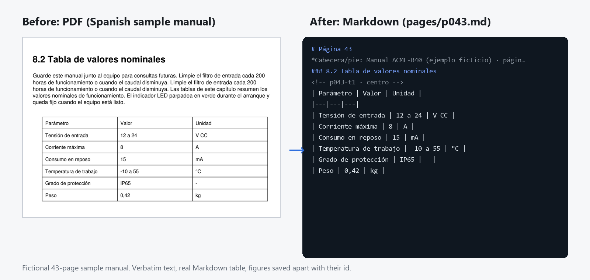

# 📄 PDF → Markdown para cualquier IA

[](https://github.com/Mad-AI-Lab/pdf-a-markdown-ia/releases) [](LICENSE) 

🇬🇧 [English](README.md) · 🇪🇸 Español

Convierte cualquier PDF (digital, escaneado o mixto) en **Markdown troceado por páginas**, listo para Claude, ChatGPT, Gemini, Copilot o modelos locales, **gastando el mínimo de tokens**.

> **¿Cuánto ahorra?** En un manual de prueba de 43 páginas, el documento entero ocupa **~35.000 tokens**. Con este kit, la IA lee el índice y solo la página que necesita: **~530 tokens, un 98 % menos.**



- 🔒 **Local y gratis.** El PDF no sale de tu ordenador. Sin APIs, sin registro.
- 🤖 **Listo para agentes de IA.** Claude Code, Codex, Cursor, Gemini CLI y Copilot lo usan solos: el repo trae sus instrucciones (`CLAUDE.md`, `AGENTS.md`, `GEMINI.md`…). Abres la carpeta y le pides "convierte este PDF". [Ver cómo](#usarlo-con-tu-ia)
- 📝 **Texto original intacto.** No se resume ni se reescribe. Lo leído por OCR va marcado `⟨ocr N %⟩`.
- 🖼️ **Figuras, planos y tablas aparte**, en WebP (sin pérdida para planos, con pérdida solo para fotos) y tablas en `.md` + `.csv`, enlazadas a su página y posición.
- 🔍 **OCR con Tesseract** para páginas escaneadas y texto dentro de imágenes.
- ✅ **Validación automática:** cobertura de palabras PDF → salida, referencias rotas, duplicados y confianza del OCR.
- ⚖️ **Licencias permisivas:** motor por defecto pdfplumber (MIT) + pypdfium2 (Apache/BSD).

## Instalación

Requisitos: **Python 3.9+**. Las librerías se instalan solas la primera vez, o a mano:

```bash
git clone https://github.com/Mad-AI-Lab/pdf-a-markdown-ia.git
cd pdf-a-markdown-ia
pip install -r requirements.txt
```

OCR (opcional, solo para escaneados):

| Sistema | Comando |
|---|---|
| Windows | `winget install -e --id UB-Mannheim.TesseractOCR` (el script lo intenta solo) |
| macOS | `brew install tesseract` |
| Linux | `sudo apt install tesseract-ocr` |

Los idiomas del OCR se descargan solos a `tessdata/`.

## Uso rápido

```bash
# 1. Copia tus PDF en input/
# 2. Convierte
python scripts/pdf_to_md.py input/
python scripts/pdf_to_md.py "input/manual.pdf" --idiomas spa+eng+fra --dpi 200
```

| Opción | Efecto |
|---|---|
| `--ocr auto\|todo\|no` | Cuándo hacer OCR (por defecto `auto`) |
| `--idiomas spa+eng` | Idiomas de Tesseract |
| `--dpi 150` | Resolución de figuras (planos vectoriales ≥ 200) |
| `--completo` | Genera también `documento-completo.md` |
| `--out <carpeta>` | Carpeta de salida (por defecto `output/`) |
| `--motor libre\|pymupdf` | `libre` por defecto. `pymupdf` es opcional y AGPL |

## Qué genera

```
output/<nombre-del-pdf>/
├── INDICE.md        ← punto de entrada: capítulos con su rango de páginas
├── paginas.md       ← una línea por página (tokens, figuras, tablas, tema)
├── pages/p001.md    ← texto literal de cada página, con figuras y tablas en su sitio
├── images/          ← figuras y planos en WebP (id p004-f2)
├── tables/          ← tablas en .md y .csv (id p005-t1)
├── refs.md          ← id → página, posición, sección, texto ancla
├── manifest.json    ← metadatos completos
└── _validacion.md   ← cobertura, OCR y avisos
```

## Usarlo con tu IA

El kit trae instrucciones para cada herramienta. Abre la carpeta del repo y pregunta:

| Herramienta | Lee automáticamente |
|---|---|
| **Claude Code** | `CLAUDE.md` + skill `.claude/skills/pdf-a-markdown-ia/SKILL.md` |
| **OpenAI Codex CLI, Cursor, Windsurf, Aider, Zed…** | `AGENTS.md` |
| **Gemini CLI** | `GEMINI.md` |
| **GitHub Copilot** | `.github/copilot-instructions.md` |
| **ChatGPT / Gemini / Claude web, Projects, Gems** | Pega el bloque de [`LEEME-IA.md`](LEEME-IA.md), sube `INDICE.md` y después solo las páginas que pida |

### Instalar solo la skill en Claude Code (para todos tus proyectos)

Copia la carpeta `.claude/skills/pdf-a-markdown-ia/` a `~/.claude/skills/` y deja el repo clonado. La skill ejecuta `scripts/pdf_to_md.py` desde la raíz del repo.

## Herramientas extra

- `scripts/comparar_motores.py <carpeta>` compara el motor libre con PyMuPDF en tiempo, memoria y calidad. Necesita `pymupdf` y `psutil`.
- `.vscode/tasks.json` contiene tareas de VS Code para convertir con un clic (`Ctrl+Shift+B`).

## Licencia

[MIT](LICENSE). Dependencias: pdfplumber/pdfminer.six (MIT), pypdfium2/PDFium (Apache-2.0/BSD-3), Pillow (MIT-CMU), Tesseract (Apache-2.0). PyMuPDF (AGPL-3.0) es **opcional** y no se instala por defecto.

> ⚠️ La conversión es una ayuda. En esquemas eléctricos, medidas y avisos de seguridad, consulta siempre el documento original.
