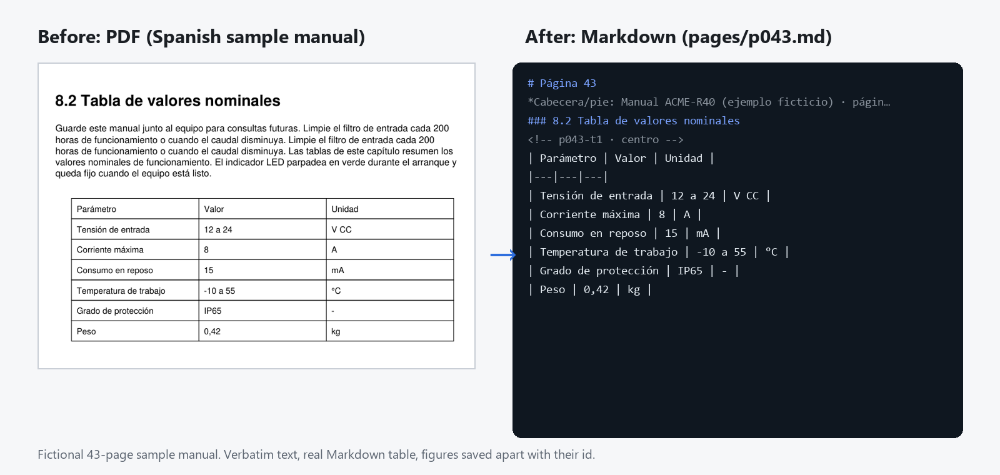

# 📄 PDF → Markdown for any AI

[](https://github.com/Mad-AI-Lab/pdf-a-markdown-ia/releases) [](LICENSE) 

🇬🇧 English · 🇪🇸 [Español](README.es.md)

Convert any PDF (digital, scanned or mixed) into **page-split Markdown**, ready for Claude, ChatGPT, Gemini, Copilot or local models, **using as few tokens as possible**.

> **How much does it save?** On a 43-page test manual, the whole document is **~35,000 tokens**. With this kit the AI reads the index and only the page it needs: **~530 tokens, 98 % less.**



- 🔒 **Local and free.** Your PDF never leaves your computer. No APIs, no sign-up.
- 🤖 **Ready for AI agents.** Claude Code, Codex, Cursor, Gemini CLI and Copilot use it on their own: the repo ships their instructions (`CLAUDE.md`, `AGENTS.md`, `GEMINI.md`…). Open the folder and ask "convert this PDF". [See how](#use-it-with-your-ai)
- 📝 **Original text untouched.** Nothing is summarised or rewritten. Text read by OCR is tagged `⟨ocr N %⟩`.
- 🖼️ **Figures, diagrams and tables saved apart**, as WebP (lossless for diagrams, lossy only for photos) and tables as `.md` + `.csv`, linked to their page and position.
- 🔍 **OCR with Tesseract** for scanned pages and text inside images.
- ✅ **Automatic validation:** PDF → output word coverage, broken references, duplicates and OCR confidence.
- ⚖️ **Permissive licences:** default engine pdfplumber (MIT) + pypdfium2 (Apache/BSD).

> ℹ️ Output file names and command options are in Spanish (`INDICE.md` = index, `paginas.md` = pages, `--idiomas` = languages). The content of your PDF stays in its original language.

## Installation

Requirements: **Python 3.9+**. Libraries install themselves on first run, or by hand:

```bash
git clone https://github.com/Mad-AI-Lab/pdf-a-markdown-ia.git
cd pdf-a-markdown-ia
pip install -r requirements.txt
```

OCR (optional, only for scanned PDFs):

| System | Command |
|---|---|
| Windows | `winget install -e --id UB-Mannheim.TesseractOCR` (the script tries it for you) |
| macOS | `brew install tesseract` |
| Linux | `sudo apt install tesseract-ocr` |

OCR languages download automatically into `tessdata/`.

## Quick start

```bash
# 1. Copy your PDFs into input/
# 2. Convert
python scripts/pdf_to_md.py input/
python scripts/pdf_to_md.py "input/manual.pdf" --idiomas eng+spa+fra --dpi 200
```

| Option | Effect |
|---|---|
| `--ocr auto\|todo\|no` | When to run OCR (`auto` by default, `todo` = every page) |
| `--idiomas eng+spa` | Tesseract languages |
| `--dpi 150` | Figure resolution (vector diagrams ≥ 200) |
| `--completo` | Also writes `documento-completo.md` (full document) |
| `--out <folder>` | Output folder (`output/` by default) |
| `--motor libre\|pymupdf` | `libre` by default. `pymupdf` is optional and AGPL |

## What you get

```
output/<pdf-name>/
├── INDICE.md        ← entry point: chapters with their page ranges
├── paginas.md       ← one line per page (tokens, figures, tables, topic)
├── pages/p001.md    ← verbatim text of each page, with figures and tables in place
├── images/          ← figures and diagrams as WebP (id p004-f2)
├── tables/          ← tables as .md and .csv (id p005-t1)
├── refs.md          ← id → page, position, section, anchor text
├── manifest.json    ← full metadata
└── _validacion.md   ← coverage, OCR and warnings
```

## Use it with your AI

The kit includes instructions for each tool. Open the repo folder and ask:

| Tool | Reads automatically |
|---|---|
| **Claude Code** | `CLAUDE.md` + skill `.claude/skills/pdf-a-markdown-ia/SKILL.md` |
| **OpenAI Codex CLI, Cursor, Windsurf, Aider, Zed…** | `AGENTS.md` |
| **Gemini CLI** | `GEMINI.md` |
| **GitHub Copilot** | `.github/copilot-instructions.md` |
| **ChatGPT / Gemini / Claude web, Projects, Gems** | Paste the block from [`LEEME-IA.md`](LEEME-IA.md), upload `INDICE.md`, then only the pages it asks for |

### Install just the skill in Claude Code (for all your projects)

Copy the `.claude/skills/pdf-a-markdown-ia/` folder to `~/.claude/skills/` and keep the repo cloned. The skill runs `scripts/pdf_to_md.py` from the repo root.

## Extra tools

- `scripts/comparar_motores.py <folder>` compares the free engine with PyMuPDF on time, memory and quality. Needs `pymupdf` and `psutil`.
- `.vscode/tasks.json` has VS Code tasks to convert with one click (`Ctrl+Shift+B`).

## License

[MIT](LICENSE). Dependencies: pdfplumber/pdfminer.six (MIT), pypdfium2/PDFium (Apache-2.0/BSD-3), Pillow (MIT-CMU), Tesseract (Apache-2.0). PyMuPDF (AGPL-3.0) is **optional** and not installed by default.

> ⚠️ The conversion is an aid. For wiring diagrams, measurements and safety warnings, always check the original document.
